<div align="center">


# Launchbay

**Ship a service in minutes, not tickets.**

A self-service internal developer platform. Pick a template, name your service, and Launchbay
creates the repo, provisions its cloud resources with Terraform, runs a tested, scanned and signed
pipeline, and lets Argo CD put it live.

[](https://github.com/paighanutkarsh2410-lab/launchbay/actions/workflows/ci.yml)


<br />

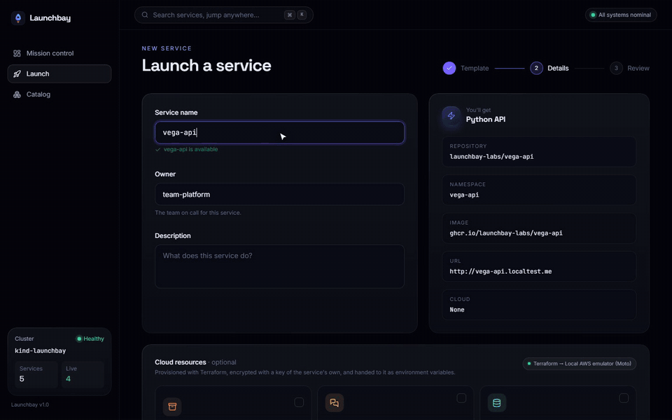

<sub>A real launch: a GitHub repo, Terraform resources, a tested, scanned and signed build, and an
Argo CD deploy. The two-minute wait for CI is fast-forwarded.
<a href="https://launchbay-593.pages.dev/media/launchbay-demo.mp4">Watch the full demo</a> or
<a href="https://launchbay-593.pages.dev">try the live demo</a>.</sub>

</div>

---

## Why

Starting a new service usually means a ticket for a repo, another for CI, another for a namespace,
and a week of waiting. Platform teams fix this with a *golden path*: one paved, approved way to go
from idea to production. Launchbay is that path, end to end, running on a single laptop.

## What a launch does

| # | Stage | What happens |
|---|---|---|
| 1 | **Validate** | Name is DNS-safe and unused, template exists, owner is set |
| 2 | **Repository** | A GitHub App creates the repo and renders the template into its first commit |
| 3 | **Cloud** | Terraform provisions the S3 bucket, SQS queue and DynamoDB table it asked for |
| 4 | **Build & sign** | The template's CI tests, scans with Trivy, builds, pushes to GHCR and signs with cosign |
| 5 | **GitOps** | A manifest for the service, with its resources' variables, is committed to `launchbay-gitops` |
| 6 | **Deploy** | An Argo CD ApplicationSet turns the manifest into an app in its own namespace |
| 7 | **Live** | The health check passes and the service gets its URL |

Every stage is stored and streamed to the portal over Server-Sent Events, so you watch the launch
happen: logs scroll in, the timeline fills, and the rocket flies.

## How it fits together

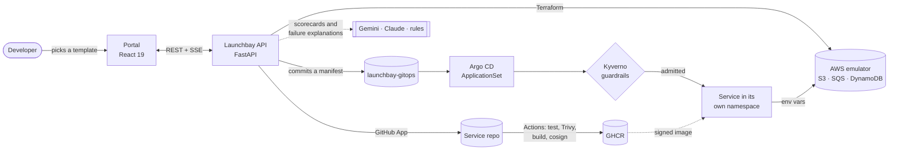

Everything runs on one laptop: a kind cluster in Docker, with Argo CD, Kyverno, Traefik and the AWS
emulator inside it. GitHub (repos, Actions, GHCR) is the only outside service.

## Tour

| | |
|---|---|
| 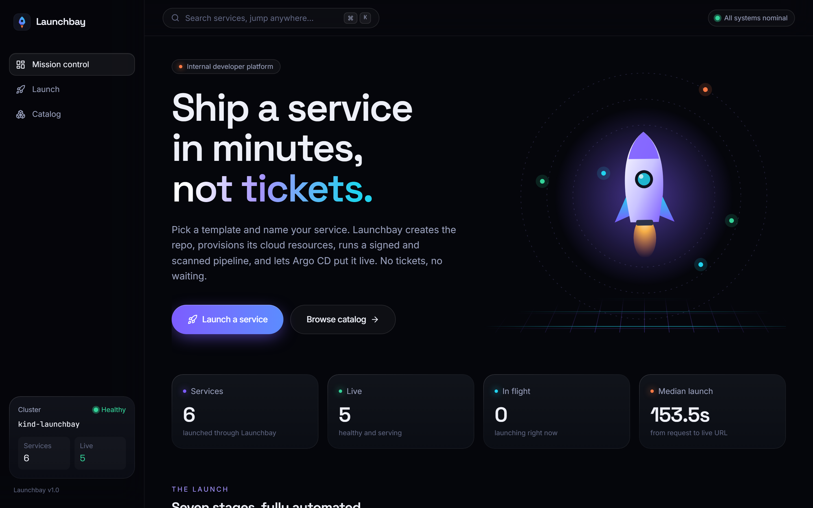 | 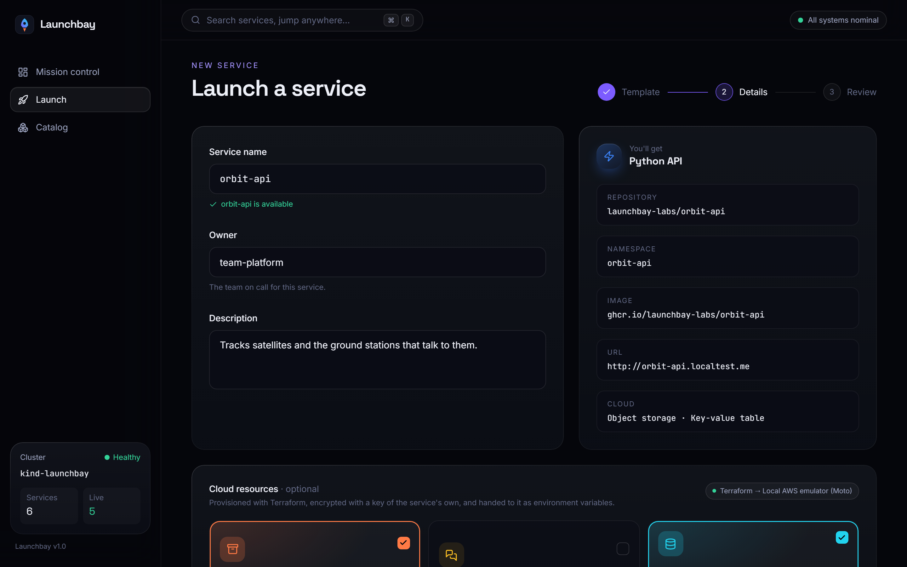 |
| **Mission control.** Fleet stats, the seven stages, the guardrails and every service's scorecard. | **Launch wizard.** Template, name (checked live against GitHub), owner and the cloud resources the service needs. |
| 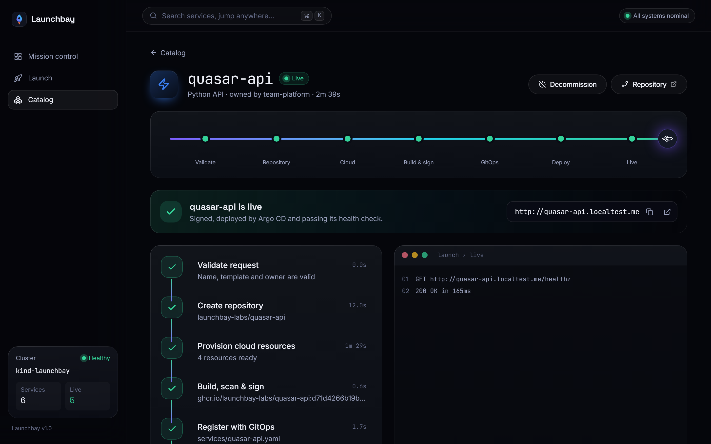 | 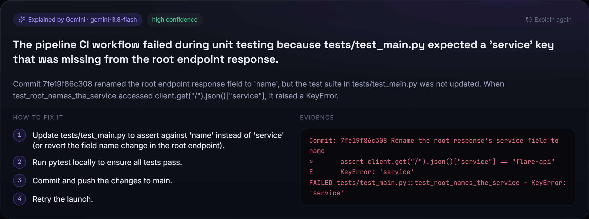 |
| **A live service.** The streamed timeline, each stage's log and the service's URL. | **A failure, explained.** Gemini read the failed CI job's log and found the broken test. |
| 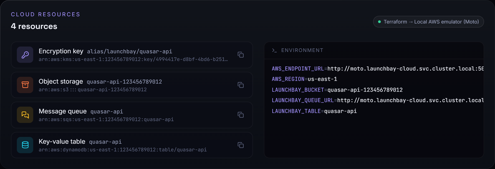 | 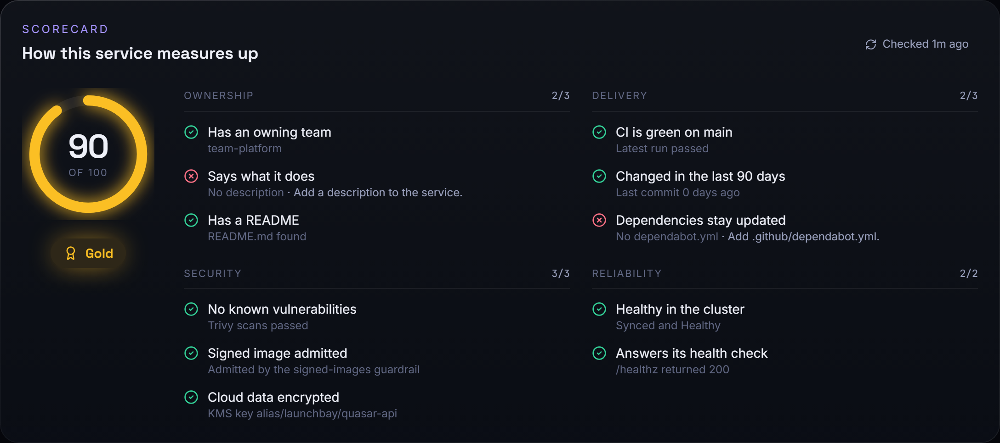 |
| **Cloud resources.** What Terraform made, each encrypted with the service's own KMS key, and the env vars the pod gets. | **Scorecard.** Eleven checks, live from GitHub, Argo CD and the service's health check. |

<details>
<summary>More: guardrails, the fleet leaderboard, the catalog and the phone layout</summary>

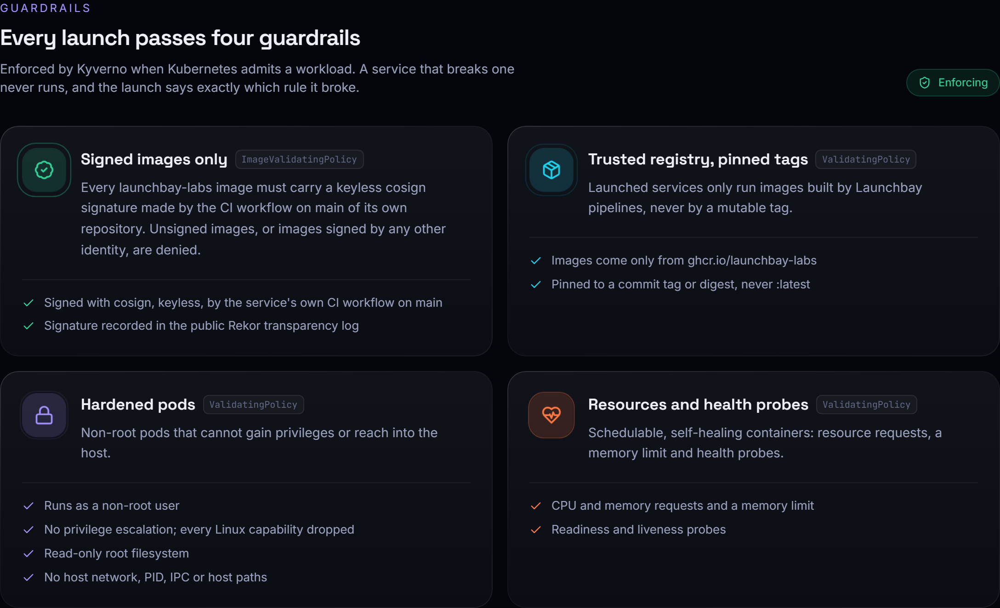
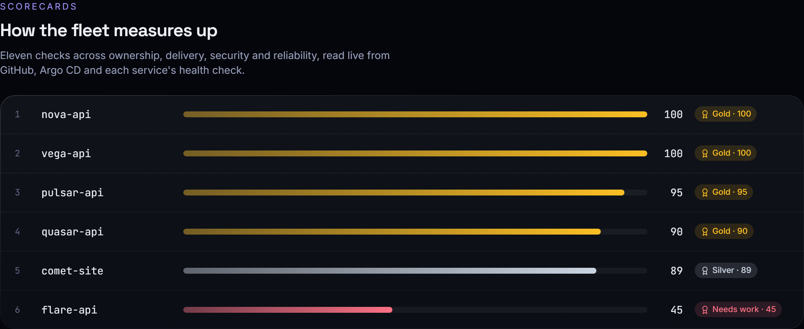
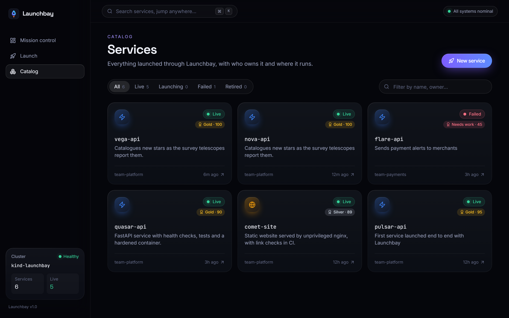
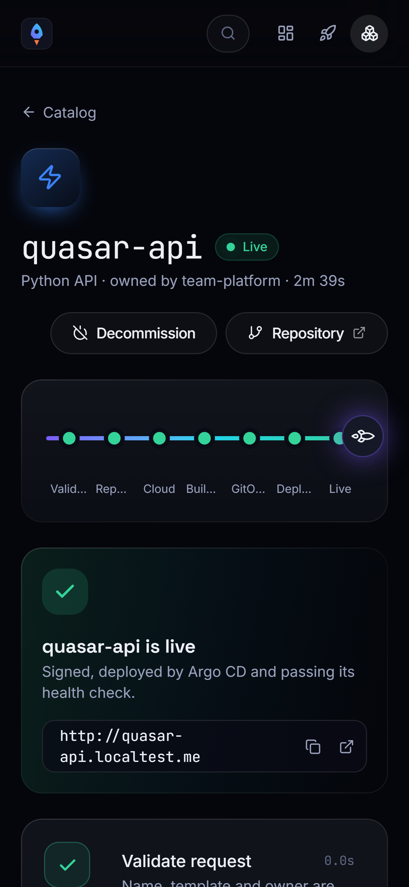

</details>

## Highlights

- **Live mission view.** A streamed timeline, per-stage terminal and an animated trajectory, built
  with React, Motion and Tailwind CSS. Respects `prefers-reduced-motion`.
- **Retry and decommission.** A failed launch resumes at the stage that failed and keeps the ones
  that passed, following the newest commit so a pushed fix is picked up. Decommissioning removes
  the GitOps manifest (Argo CD prunes everything) and archives or deletes the repo, behind a
  type-the-name confirmation.
- **Guardrails, enforced.** Kyverno admits a workload only if its image is signed with cosign by
  *that service's own* CI on `main`, comes from `ghcr.io/launchbay-labs` with a pinned tag, runs
  non-root with a read-only root filesystem and no privilege escalation or host access, and declares
  resources and health probes.
  The policies use Kyverno's CEL-based `ValidatingPolicy` and `ImageValidatingPolicy`; CI tests them
  with `kyverno test`, `scripts/verify-guardrails.sh` proves them on the live cluster, and a blocked
  deploy names the rule it broke.
- **Cloud resources with Terraform.** A service can ask for object storage (S3), a message queue
  (SQS, with a dead-letter queue) and a key-value table (DynamoDB). Launchbay applies one Terraform
  root per service, with its own state, through reusable modules: every resource is encrypted with
  a KMS key of the service's own, tagged with its owner, and handed to the service as environment
  variables through GitOps. Locally it all runs on [Moto](https://github.com/getmoto/moto), an
  open-source AWS emulator, inside the cluster; the same Terraform targets real AWS by leaving out
  the endpoint. The modules have mocked unit tests and an apply-and-destroy integration test in CI,
  and the API re-applies them on start, so a restarted emulator is repopulated.
- **Scorecards.** Every launched service is graded Gold, Silver, Bronze or "Needs work" on eleven
  weighted checks across ownership, delivery, security and reliability: CI green on main, Trivy
  scans clean, signed image admitted, Argo CD healthy, `/healthz` answering, a README, Dependabot,
  recent commits, encrypted cloud data. Facts come live from GitHub, Argo CD and the service itself;
  a check that can't be evaluated is skipped, never counted against the service.
- **Failed launches, explained.** One click on a failed launch pulls the evidence together (the
  stage log, the failed GitHub Actions job's log, Argo CD's status, the guardrails) and returns what
  went wrong, why, and the steps to fix it. The model is pluggable: Gemini (the free tier is plenty)
  or Claude, each returning a schema-checked answer; with no key at all, built-in rules recognise the
  common failures (failing tests, a vulnerability, a guardrail denial, a Terraform error, a timeout).
  Whatever the model can't answer (a rate limit, an outage, a refusal) falls back to the rules, and
  the panel says which one answered. Explanations are stored with the launch, so each failure is
  explained once.
- **Provider architecture.** The launcher talks to the world only through providers. `GitHubProvider`
  does it for real; `DemoProvider` simulates every stage so the portal runs with no credentials.
- **GitHub App, not tokens.** Scoped permissions and short-lived installation tokens.
- **Supply chain built in.** Every template ships a pipeline with Trivy scans and keyless cosign
  signing; images are deployed by digest.
- **Golden-path templates.** Python (FastAPI), Node (Express) and a static site, each with tests,
  a non-root container and CI.

## Try it

**[launchbay-593.pages.dev](https://launchbay-593.pages.dev)**: a public demo runs the same portal
and API with every launch simulated, so anyone can click
through a launch without credentials. It is seeded from this Launchbay's real services and kept safe
for the open internet (read-only showcase, rate limits, automatic cleanup). How it is hosted for
free, on Cloudflare Pages and Render: [docs/public-demo.md](docs/public-demo.md).

## Develop

For working on Launchbay itself, run the API and portal in demo mode (no cluster or accounts):

You need Python 3.12 and Node 22.

```bash
# API (demo mode, no credentials needed)
cd services/api
python -m venv .venv && .venv/Scripts/activate   # source .venv/bin/activate on macOS/Linux
pip install -e ".[dev]"
uvicorn app.main:app --reload

# Portal, in a second terminal
cd apps/portal
npm install
npm run dev
```

Failed launches are explained by built-in rules out of the box. To use a model instead, save a key
outside the repo; Launchbay picks it up on start:

- **Gemini** (free): create a key at [Google AI Studio](https://aistudio.google.com) and save it as
  `~/.launchbay/gemini-api-key` (or set `LAUNCHBAY_GEMINI_API_KEY`).
- **Claude**: save an Anthropic API key as `~/.launchbay/anthropic-api-key` (or set
  `LAUNCHBAY_ANTHROPIC_API_KEY`).

With both present Claude is used; set `LAUNCHBAY_EXPLAINER=gemini` (or `claude`, `rules`) to choose.

Open http://localhost:5173 and launch a service. Press <kbd>Ctrl</kbd>/<kbd>⌘</kbd> + <kbd>K</kbd> for
the command palette.

## Run your own

Run the real thing on your machine, launching into your own GitHub organization:

```bash
./launchbay up --org <your-org>
```

One command brings up the platform (a kind cluster with Traefik, the AWS emulator, Kyverno and Argo
CD, pinned and checksum-verified), installs the API, builds the portal and opens
http://localhost:8000/setup. There, **Connect GitHub** creates a GitHub App for your organization
through GitHub's App Manifest flow and installs it: no App ids or keys to copy, and the key stays in
`~/.launchbay`. Launchbay then creates your `launchbay-gitops` repo and switches from demo mode to
real launches. The full guide, including private images, AI keys and removal:
[docs/self-hosting.md](docs/self-hosting.md).

| What | Where |
|---|---|
| Launchbay | http://localhost:8000 |
| Argo CD | http://argocd.localtest.me |
| Any launched service | http://&lt;name&gt;.localtest.me |
| AWS emulator (Moto) | http://aws.localtest.me |
| A service's view of its resources (Python template) | http://&lt;name&gt;.localtest.me/cloud |

Check the guardrails against the live cluster at any time (server-side dry runs, nothing is created):

```bash
./scripts/verify-guardrails.sh
```

`localtest.me` is a public DNS name that always resolves to `127.0.0.1`, so every service gets a
real hostname with no hosts-file edits. Tear everything down with `kind delete cluster --name launchbay`.

```
 services/<name>.yaml ──► ApplicationSet ──► Application ──► namespace <name>
   (launchbay-gitops)      (git generator)    (charts/service)   Deployment · Service · Ingress · PDB
```

## Tests

| Suite | What it proves | Where it runs |
|---|---|---|
| API (pytest, 54 tests) | Launcher, retries, providers, Terraform runner, scorecards, every explainer fallback | CI |
| Portal smoke tests (Playwright) | A launch from the wizard to a live service, the catalog and command palette, no sideways scrolling on a phone | CI, against the API in demo mode |
| Guardrails (`kyverno test`, 36 cases) | Each policy admits the compliant pod and rejects each kind of bad one | CI |
| Guardrails, live | The same rules, plus signature checks, enforced by the cluster's admission webhooks | `scripts/verify-guardrails.sh` |
| Terraform | Module behaviour with a mocked provider, then a real apply and destroy against Moto | CI |
| Templates | Each template renders, passes its own tests and builds its image | CI |
| Trivy | No fixable critical or high vulnerabilities in the repo | CI |

Run the smoke tests locally with `npm run e2e` in `apps/portal` (they start their own API and portal
on spare ports). `node scripts/capture.mjs screenshots|demo` in `apps/portal` regenerates the images
and video in `docs/media` from a running Launchbay.

## Layout

| Path | What |
|---|---|
| `apps/portal` | React 19 + TypeScript portal, its Playwright smoke tests and the capture script |
| `services/api` | FastAPI API, launcher, providers, scorecards and the failure explainer |
| `templates/` | Golden-path templates rendered into new repos |
| `platform/` | kind, Traefik and Argo CD configuration, and the ApplicationSet |
| `platform/terraform/` | Terraform modules (bucket, queue, table) and the per-service root, with tests |
| `platform/cloud/` | The Moto AWS emulator, run in the cluster |
| `launchbay` | One command to install, start and stop a self-hosted Launchbay |
| `scripts/platform-up.sh` | Brings up the cluster and platform services (called by `launchbay up`) |
| `platform/gitops/` | What a new organization's `launchbay-gitops` repo starts from |
| `platform/kyverno/` | Guardrail policies and their `kyverno test` suite |
| `scripts/verify-guardrails.sh` | Proves the guardrails on the live cluster |
| `docs/architecture.md` | Design and roadmap |
| `docs/media/` | Screenshots and the demo video |
| `render.yaml` | The public demo's API on Render (the portal goes on Cloudflare Pages) |

## Roadmap

- [x] **Phase 1**: portal, launcher, templates, demo and GitHub providers
- [x] GitOps repo and Argo CD ApplicationSet on kind, behind Traefik
- [x] GitHub App on the `launchbay-labs` org: real launches, click to live URL in about 2.5 minutes
- [x] Retry from the failed stage and decommission (archive or delete) from the portal
- [x] **Phase 2**: Kyverno guardrails (CEL policies), signed-image enforcement, policy tests in CI
- [x] **Phase 3**: cloud resources (S3, SQS, DynamoDB) with Terraform, on a local AWS emulator
- [x] **Phase 4**: service scorecards and an AI helper (Gemini or Claude) that explains failed launches
- [x] **Phase 5**: polish (phone layouts, accessibility, read-only root filesystems), Playwright smoke
  tests, screenshots and a demo video
- [x] Public demo on Cloudflare Pages and Render, free; self-hosting with `./launchbay up` and
  one-click GitHub connect
